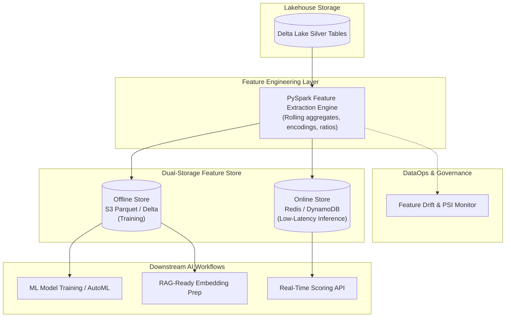

# AI and Machine Learning Data Platform

[](https://www.python.org/downloads/)
[](https://databricks.com/)
[](https://spark.apache.org/)
[](https://www.terraform.io/)

> **Portfolio reference implementation** demonstrating Python feature aggregation, population stability index (PSI) drift checks, RAG-ready document normalization, and Terraform examples for AWS infrastructure. Its architectural diagrams describe potential cloud integrations; the runnable unit-tested modules are local, dependency-light components.

---

## 🏗️ Reference Architecture (design goals, not a deployed environment)



---

## 🚀 Key Capabilities

* **Python Feature Aggregation**: Validates transaction records and calculates average order value, transaction counts, and high-value customer flags per user.
* **Online/Offline Feature Store Design**: Architecture illustrates possible offline Parquet/Delta and online stores; this repository does not implement a serving API, point-in-time joins, or latency benchmarks.
* **PSI Drift Calculations**: Validated histogram comparisons and severity classification; automated alerting and production scheduling are outside the current implementation.
* **RAG-Ready Record Preparation**: Normalizes document IDs and text, estimates tokens by word count, and flags records as ready; it does not generate embeddings, split chunks, or write to a vector database.
* **Infrastructure as Code Examples**: Terraform definitions illustrate an AWS S3 bucket and DynamoDB table; they are not a complete Databricks, IAM, or production deployment.

### Drift input contract

`FeatureDriftDetector` accepts either histogram counts or proportions and normalizes
each distribution before calculating PSI. Expected and actual inputs must contain
the same non-empty set of bins with finite, non-negative numeric values. An all-zero
distribution is rejected, while individual zero-frequency bins use epsilon smoothing
so the score remains finite.

The detector returns `NORMAL` below 0.1, `MODERATE_DRIFT` from 0.1 through 0.2,
and `SIGNIFICANT_DRIFT` above 0.2.

### Feature input contract

`compute_user_features` requires a list of transaction dictionaries. Each transaction
must contain a non-empty string `user_id` and a finite numeric `amount`; finite
`Decimal` values are accepted, while booleans, numeric strings, missing fields,
`NaN`, and infinities are rejected with an error that identifies the record index.
User IDs are trimmed before aggregation. Amounts are normalized to floats, so this
example is intended for feature computation rather than exact financial reconciliation.

### RAG dataset input contract

`RAGDatasetPreparer.prepare_dataset` requires a list of document dictionaries with
unique, non-empty string `id` values. IDs and text are trimmed without modifying the
source records, and duplicate IDs are rejected after normalization to prevent silent
vector-store collisions. Text must be a string when supplied; a missing text field is
represented as an empty, not-ready record. Validation errors identify the record index.

Run the dependency-free regression suite with:

```bash
python -m unittest discover -s tests -v
```

---

## 📂 Project Structure

```
ai-ml-data-platform/
├── .github/workflows/ci.yml       # GitHub Actions regression checks
├── docs/architecture.md           # Architecture design
├── src/
│   ├── __init__.py
│   ├── features/
│   │   ├── feature_definitions.py # Pydantic feature schema
│   │   └── feature_pipeline.py    # Python feature aggregation
│   ├── monitoring/
│   │   └── drift_detector.py      # PSI feature drift detection
│   └── rag/
│       └── embedding_preparer.py  # RAG dataset generator
├── terraform/
│   ├── main.tf                    # AWS S3 and DynamoDB examples
│   └── variables.tf
├── tests/
│   ├── test_drift_detector.py     # PSI contract regression tests
│   ├── test_features.py           # Feature pipeline regression tests
│   └── test_rag_preparer.py       # RAG preparation regression tests
├── docker-compose.yml
├── requirements.txt
└── .gitignore
```

---

## ⚡ Quickstart

```bash
git clone https://github.com/devmasonmir/ai-ml-data-platform.git
cd ai-ml-data-platform
python -m venv .venv
# Linux/macOS: source .venv/bin/activate
# Windows PowerShell: .venv\Scripts\Activate.ps1
pip install -r requirements.txt
python -m unittest discover -s tests -v
python -m src.features.feature_pipeline
```

GitHub Actions runs compilation, linting, and the dependency-free regression
suite on Python 3.10 and 3.12 for pushes to `main` and pull requests. Run the
same core checks locally with:

```bash
python -m compileall -q src tests
flake8 src tests --max-line-length=120
python -m unittest discover -s tests -v
```

---

## Scope and licensing

This repository is a portfolio/reference implementation; it does not contain employer datasets or deployed production systems. Dependencies such as PySpark and Feast are listed for future integrations and are not exercised by the dependency-free unit tests. No license file is currently included; reuse permissions have not been declared.

