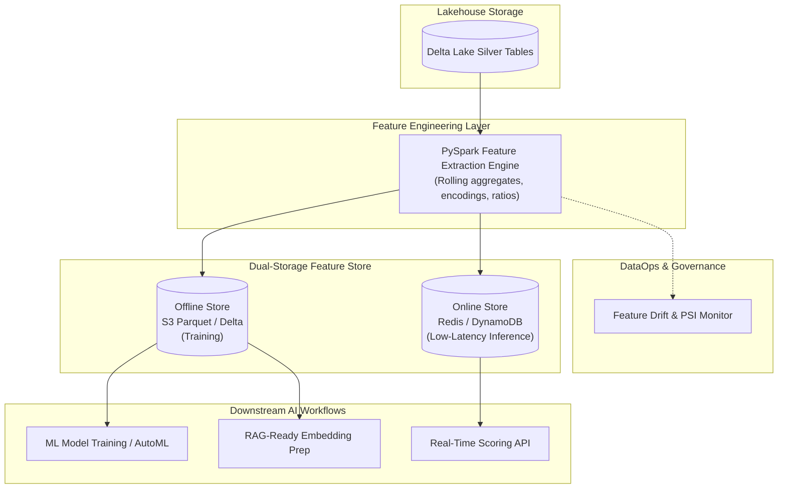

# Enterprise AI & Machine Learning Data Platform

[](https://opensource.org/licenses/MIT)
[](https://www.python.org/downloads/)
[](https://databricks.com/)
[](https://spark.apache.org/)
[](https://www.terraform.io/)
[](https://feast.dev/)

> **Scalable AI-ready data engineering platform delivering automated feature pipelines, Feast feature store integration, RAG-ready vector datasets, and feature drift monitoring on AWS and Databricks.**

---

## 🏗️ Architecture Overview



---

## 🚀 Key Capabilities

* **Automated PySpark Feature Pipelines**: Computes rolling aggregations, interaction terms, and normalized embeddings at scale.
* **Dual Feature Serving (Online / Offline)**: Consistent point-in-time correct training datasets with sub-10ms online feature serving.
* **Feature Drift & PSI Detection**: Continuous monitoring detecting distribution shifts across critical features before models degrade.
* **RAG-Ready Dataset Pipeline**: Tokenizes and chunks enterprise knowledge assets into standardized formats ready for vector DB ingestion.
* **Infrastructure as Code (Terraform)**: Full provisioning for feature stores, Databricks ML runtimes, and secure IAM roles.

### Drift input contract

`FeatureDriftDetector` accepts either histogram counts or proportions and normalizes
each distribution before calculating PSI. Expected and actual inputs must contain
the same non-empty set of bins with finite, non-negative numeric values. An all-zero
distribution is rejected, while individual zero-frequency bins use epsilon smoothing
so the score remains finite.

The detector returns `NORMAL` below 0.1, `MODERATE_DRIFT` from 0.1 through 0.2,
and `SIGNIFICANT_DRIFT` above 0.2.

### Feature input contract

`compute_user_features` requires a list of transaction dictionaries. Each transaction
must contain a non-empty string `user_id` and a finite numeric `amount`; booleans,
numeric strings, missing fields, `NaN`, and infinities are rejected with an error that
identifies the record index. User IDs are trimmed before aggregation.

Run the dependency-free regression suite with:

```bash
python -m unittest discover -s tests -v
```

---

## 📂 Project Structure

```
ai-ml-data-platform/
├── ci/ci.yml                      # CI pipeline
├── docs/architecture.md           # Architecture design
├── src/
│   ├── __init__.py
│   ├── features/
│   │   ├── feature_definitions.py # Feast / Databricks feature schemas
│   │   └── feature_pipeline.py    # PySpark feature computation
│   ├── monitoring/
│   │   └── drift_detector.py      # PSI feature drift detection
│   └── rag/
│       └── embedding_preparer.py  # RAG dataset generator
├── terraform/
│   ├── main.tf                    # S3, IAM, Databricks cluster IaC
│   └── variables.tf
├── tests/
│   ├── test_drift_detector.py     # PSI contract regression tests
│   └── test_features.py           # Unit tests
├── docker-compose.yml
├── requirements.txt
└── .gitignore
```

---

## ⚡ Quickstart

```bash
git clone https://github.com/devmasonmir/ai-ml-data-platform.git
cd ai-ml-data-platform
python -m venv venv
.\venv\Scripts\activate
pip install -r requirements.txt
pytest tests/ -v
python -m src.features.feature_pipeline
```

---

## 📜 License
MIT License.
